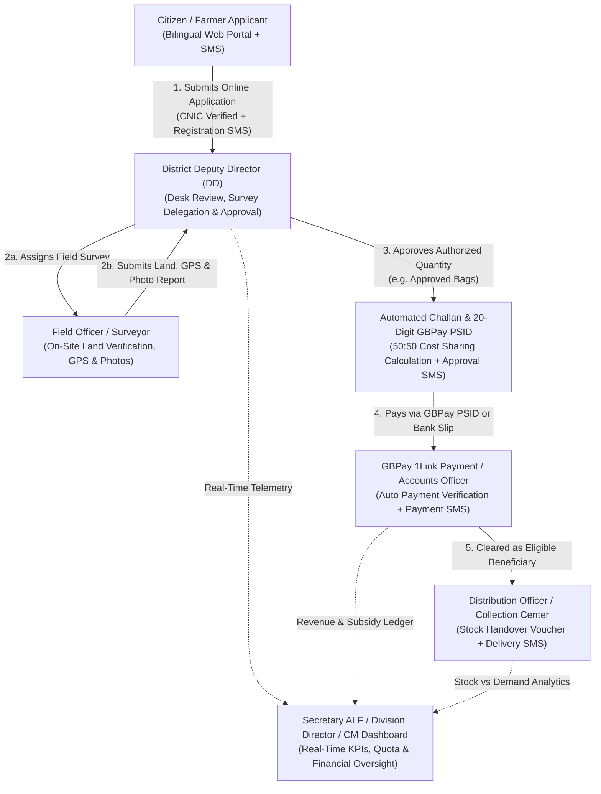

# Agriculture, Livestock & Fisheries Department (ALF) — Gilgit-Baltistan
## Complete Role-Based Standard Operating Procedures (SOP) & User Manual

**Document Version:** 2.0 (Enterprise Release)  
**System Name:** ALF Gilgit-Baltistan Citizen Schemes Portal & Executive MIS  
**Prepared For:** Government of Gilgit-Baltistan — Agriculture, Livestock & Dairy Development, and Fisheries Department  
**Portal Languages:** Bilingual (English & اردو)  

---

## Table of Contents

1. [System Overview & Administrative Architecture](#1-system-overview--administrative-architecture)
2. [Role-Based Access Control (RBAC) Matrix & Default Credentials](#2-role-based-access-control-rbac-matrix--default-credentials)
3. [End-to-End Application Lifecycle & State Machine](#3-end-to-end-application-lifecycle--state-machine)
4. [Role 1: Public Citizen / Farmer Applicant Manual](#4-role-1-public-citizen--farmer-applicant-manual)
5. [Role 2: Chief Minister (CM) Cell & Secretary ALF Manual](#5-role-2-chief-minister-cm-cell--secretary-alf-manual)
6. [Role 3: Departmental Directors Manual (Agriculture, Livestock, Fisheries)](#6-role-3-departmental-directors-manual-agriculture-livestock-fisheries)
7. [Role 4: Division Director Manual (Gilgit, Skardu/Baltistan, Diamer)](#7-role-4-division-director-manual-gilgit-skardubaltistan-diamer)
8. [Role 5: District Deputy Director (DD) / District Officer Manual](#8-role-5-district-deputy-director-dd--district-officer-manual)
9. [Role 6: Field Officer / Site Surveyor Manual](#9-role-6-field-officer--site-surveyor-manual)
10. [Role 7: Accounts Officer & GBPay 1Link Billing Manual](#10-role-7-accounts-officer--gbpay-1link-billing-manual)
11. [Role 8: Distribution Officer & Stock Logistics Manual](#11-role-8-distribution-officer--stock-logistics-manual)
12. [Role 9: Super Admin (CMS, Gateways, SMS & Security Audit) Manual](#12-role-9-super-admin-cms-gateways-sms--security-audit-manual)

---

## 1. System Overview & Administrative Architecture

The **ALF Gilgit-Baltistan Portal & MIS** is an end-to-end e-Governance platform that digitizes citizen subsidy schemes across **3 Core Departments**, **3 Administrative Divisions**, and **10 Districts** of Gilgit-Baltistan:

- **Departments:**
  1. **Agriculture Department** (e.g., *Distribution of Certified Wheat Seed on 50:50 Cost-Sharing Basis*)
  2. **Livestock & Dairy Development Department**
  3. **Fisheries Department**
- **Divisions & Districts:**
  - **Gilgit Division:** Gilgit, Hunza, Nagar, Ghizer
  - **Skardu (Baltistan) Division:** Skardu, Shigar, Ghanche, Kharmang
  - **Diamer Division:** Diamer, Astore

---

## 2. Role-Based Access Control (RBAC) Matrix & Default Credentials

> [!IMPORTANT]
> The platform enforces strict **Administrative Scope Isolation** (`Global`, `Division`, `District`, and `Department`) and **Separation of Duties**. Every sensitive action—including status transitions, quantity adjustments, payment clearances, and unmasked exports—is recorded in an immutable audit trail.

| # | Role Name | Administrative Scope | Core Responsibilities | Default Login Account (Localhost) |
| :- | :--- | :--- | :--- | :--- |
| **1** | **Citizen / Farmer** | Public Portal | Apply for schemes, verify CNIC, track status using Application ID & CNIC, download Challan/PSID, upload payment proof. | Public URL: `/schemes` & `/track` |
| **2** | **Secretary** | Global (Read-Only Oversight) | Executive oversight across all 3 departments & 10 districts, CM Dashboard, Wheat Seed MIS, masked exports, audit logs. | `secretary@alf.gb.gov.pk` |
| **3** | **Director Agriculture / Livestock / Fisheries** | Global (Departmental) | Create/edit schemes, configure dynamic forms, challan templates, SMS templates, district quotas, and directorate approvals. | Assigned via Admin User Management |
| **4** | **Division Director** | Divisional (4 or 2 Districts) | Regional monitoring across districts in the division, SLA compliance tracking, escalation oversight, and divisional exports. | `director.gilgit@alf.gb.gov.pk` `director.skardu@alf.gb.gov.pk` `director.diamer@alf.gb.gov.pk` |
| **5** | **District Deputy Director (DD)** | District + Department | Primary operational authority: review applications, request corrections, assign Field Officers, approve quantity, reject, or reactivate dormant cases. | `dd.gilgit@alf.gb.gov.pk` |
| **6** | **Field Officer** | Assigned Applications in District | Schedule field visits, inspect land/water, capture 3+ GPS coordinates and land photos, and submit survey recommendations. | `fo.gilgit@alf.gb.gov.pk` |
| **7** | **Accounts Officer** | District / Global Finance | Verify manual bank deposit slips, monitor GBPay 20-digit PSID payments, reconcile challans, and clear eligible beneficiaries. | `accounts.gilgit@alf.gb.gov.pk` |
| **8** | **Distribution Officer** | Collection Center / District | Manage collection centers, record stock receipts/transfers/damages, disburse approved bags to eligible beneficiaries, and print vouchers. | `dist.gilgit@alf.gb.gov.pk` |
| **9** | **Super Admin** | Global System & CMS | Manage users, office assignments, RBAC matrix, departments, districts, CMS media, GBPay credentials, Zong CBS SMS gateway, and audit logs. | `admin@alf.gb.gov.pk` |

---

## 3. End-to-End Application Lifecycle & State Machine

Every application progresses through a deterministic, concurrency-locked (`lock_version`) lifecycle:

| Stage Code | Display Status | Triggered By | Automated System Action & SMS |
| :--- | :--- | :--- | :--- |
| `submitted` | **Submitted / Pending** | Citizen submits form | Auto-routes to District DD; sends **Registration SMS** with `{application_id}` & `{password}` (CNIC). |
| `under_review` | **Under Review** | District Deputy Director | Locks application to reviewing officer; optional status SMS. |
| `correction_required` | **Correction Required** | District Deputy Director | Sends **Correction SMS** (`{correction_remarks}`); unlocks citizen correction form on `/track`. |
| `field_survey_assigned` | **Field Survey Assigned** | District Deputy Director | Creates Field Task for selected Field Officer; sends **Field Survey SMS**. |
| `visit_scheduled` | **Visit Scheduled** | Field Officer | Records planned inspection date on application timeline. |
| `visit_completed` | **Visit Completed** | Field Officer | Records physical site visit completion timestamp. |
| `findings_submitted` | **Findings Submitted** | Field Officer | Attaches verified land (Kanals), GPS points, and photos; notifies District DD. |
| `approved` / `challan_issued` | **Approved / Challan Issued** | District Deputy Director | Records **Approved Quantity (`approved_quantity`)**, calculates 50:50 farmer share, generates **Challan No** & **20-digit GBPay PSID**, and sends **Approval SMS**. |
| `rejected` | **Rejected** | District Deputy Director | Records mandatory rejection reason; sends **Rejection SMS** (`{rejection_reason}`). |
| `payment_proof_submitted` | **Payment Proof Submitted** | Citizen | Citizen uploads bank deposit slip on `/track`; queued for Accounts Officer. |
| `payment_verified` / `eligible_beneficiary` | **Eligible Beneficiary** | GBPay 1Link API *or* Accounts Officer | Confirms payment; sends **Payment Success SMS** (`{amount_paid}`, `{psid}`); unlocks Stock Disbursement Counter. |
| `partially_distributed` | **Partially Disbursed** | Distribution Officer | Deducts partial stock from Collection Center inventory; issues voucher. |
| `fully_distributed` | **Fully Disbursed** | Distribution Officer | Deducts remaining approved quantity; issues final voucher; sends **Stock Handover SMS**. |
| `dormant` | **Dormant (Expired)** | Automated SLA / Scheduler | Marks unpaid challans past due date as Dormant, freeing reserved district quota. |
| `reactivated` | **Reactivated** | District Deputy Director | Extends challan validity by 14 days with documented DD justification. |

---

## 4. Role 1: Public Citizen / Farmer Applicant Manual

### 4.1 Exploring Schemes & Switching Language (English / اردو)
1. Open the public portal homepage (`http://localhost/alfgb`).
2. Use the top-left or top-right **Language Toggle (`EN | اردو`)** to switch the entire portal interface, scheme descriptions, and application forms between **English** and **Urdu (RTL)**.
3. Browse **Active Schemes** on the homepage or click **Schemes → On Going Schemes** in the top navigation bar.

---

### 4.2 Submitting an Online Scheme Application
1. Click **Apply Now** on any active scheme (for example, *Distribution of Wheat Seed (Cost Sharing 50:50)*).
2. **Step 1 — CNIC Verification:**
   - Enter your **13-digit CNIC** (with or without dashes) and click **Verify CNIC**.
   - The system queries the Gilgit-Baltistan Citizen/Farmer Registry and auto-populates your **Full Name**, **Father/Husband Name**, **District**, **Tehsil**, and **Village** where available.
3. **Step 2 — Geographic & Scheme-Specific Details:**
   - Select your **District**, **Tehsil**, **Union Council**, and enter your **Village** and **Active Mobile Number** (`03XXXXXXXXX`).
   - Complete the scheme-specific agronomic fields (e.g., *Land Available for Wheat in Kanals*, *Last Year Cultivated Area*, *Water Availability*, *Road Access*, and *Number of 50kg Seed Bags Required*).
4. **Step 3 — Document Upload & Submission:**
   - Attach required supporting documents (e.g., CNIC Front/Back, Land Ownership / Fard / Mutation Paper).
   - Check the declaration box and click **Submit Application**.
5. **Step 4 — Instant Confirmation & Registration SMS:**
   - An **Application Confirmation Screen** displays your unique **Application Number** (e.g., `ALF-20261028-00105`).
   - Simultaneously, the system sends a **bilingual Registration SMS** to your mobile phone containing your **Application ID** and your **13-digit CNIC as Password**.

---

### 4.3 Tracking Status, Downloading Challan & Paying Bill via GBPay PSID
1. Click **Track Application** (`/track`) in the top navigation menu.
2. Enter your **Application Number** and **13-digit CNIC (Password)** and click **Track Status**.
3. Depending on your application's stage, you can perform the following actions directly on the tracking page:
   - **If `Correction Required`:** View the Deputy Director's remarks and submit updated details/documents.
   - **If `Approved / Challan Issued`:**
     - View your **Approved Quantity** (e.g., `3 Bags`), **Farmer Share (50%) Bill Amount**, **Due Date**, and **20-Digit GBPay PSID**.
     - Click **Download Bank Challan PDF** to print the 3-copy official challan (*Bank Copy*, *Department Copy*, *Applicant Copy*) with complete cost breakdown and amount in words.
     - **Option A (Instant Digital Payment via GBPay 1Link):** Pay using the **20-digit PSID** on any 1Link mobile banking app, ATM, or bank counter. As soon as payment succeeds, GBPay notifies the portal, your status automatically updates to **Eligible Beneficiary**, and you receive a **Payment Success SMS** with the bill amount paid.
     - **Option B (Manual Bank Deposit Slip):** If paid manually at a bank branch, upload a clear photo/scan of the stamped bank receipt using the **Upload Payment Proof** form on `/track`.

---

## 5. Role 2: Chief Minister (CM) Cell & Secretary ALF Manual

**Target Users:** `Secretary`, `Super Admin`, and `Departmental Directors`  
**Navigation Path:** **Admin Sidebar → Dashboard** (`/admin`) & **CM Dashboard** (`/admin/cm-dashboard`)

### 5.1 Main Operational Dashboard (`/admin`)
Provides a high-level summary of all 10 Districts, Active Schemes, Total Applications, Registered Citizens, Pending Reviews, District Verifications, Directorate Approvals, and Disbursed Beneficiaries, along with sector-by-sector resolution rates across **Agriculture**, **Livestock**, and **Fisheries**.

---

### 5.2 Chief Minister (CM) Executive Analytics Dashboard (`/admin/cm-dashboard`)
1. Open **CM Dashboard** from the left navigation bar or top action button.
2. **Real-Time Filtering:** Filter executive telemetry by **Department**, **Division**, **District**, **Scheme**, and **Date Range** without page reloads.
3. **Executive Metrics Monitored:**
   - Total Applications vs. Approved & Disbursed Beneficiaries
   - Total Financial Subsidy Committed (Government Share vs. Farmer Cost Share)
   - District-wise Quota Utilization & Bottleneck Analysis
   - SLA Compliance (On-Track vs. Warning vs. Overdue applications)
4. **One-Click Executive Exports:** Click **Export Excel**, **Export CSV**, or **Export PDF** to generate formatted cabinet/secretariat briefing reports.

---

### 5.3 Dedicated Scheme MIS: Wheat Seed 50:50 Cost-Sharing (`/admin/schemes/wheat-mis`)
1. Click **Wheat Seed MIS** in the sidebar.
2. Monitor agronomic and financial KPIs tailored specifically for the Wheat Seed Distribution Scheme:
   - **Total Applications** broken down by Pending, Verified, Approved, Disbursed, and Rejected
   - **Available Wheat Land (Kanals & Acres)** vs. **Last Year Cultivation (Kanals)**
   - **Seed Bags (50kg Each):** Demanded vs. Approved vs. District Quota
   - **Weight Equivalents (Metric Tons & kg)**
   - **50:50 Cost-Sharing Ledger:** Total Bill Value, Government Subsidy (50%), and Farmer Share (50%)
   - **Village & Tehsil Coverage** across all 10 districts
3. Authorized Directorate/Super Admin users can click **Configure Seed Data** to update district-wise per-bag delivery rates (including transportation differentials) and district bag quotas.

---

## 6. Role 3: Departmental Directors Manual (Agriculture, Livestock, Fisheries)

**Target Users:** `Director Agriculture`, `Director Livestock`, `Director Fisheries`, `Super Admin`

### 6.1 Managing Schemes & District Quotas (`/admin/schemes`)
1. Navigate to **Sidebar → Schemes**.
2. Click **Create Scheme** (or **Edit** on an existing scheme) to configure:
   - **Bilingual Titles & Descriptions:** English and Urdu (`title_ur`, `description_ur`, `eligibility_criteria_ur`).
   - **Scheme Type:** `Ongoing` (active citizen applications) or `Proposed (CM)` (open for citizen Expression of Interest).
   - **Challan & Cost-Sharing Settings:** Enable `Requires Challan`, set `Challan Fee Per Unit`, and assign a **Challan Template**.
   - **District Quotas:** Allocate maximum beneficiary/bag quotas per district.

### 6.2 Dynamic Application Form Builder (`/admin/forms`)
1. Navigate to **Sidebar → Application Forms** and click **Form Builder** next to any scheme.
2. Add, reorder, or customize dynamic form fields:
   - **Field Types:** Text, Number, Decimal, Select Dropdown, Radio, Checkbox, Textarea, Date.
   - **Bilingual Labels:** Provide both English and Urdu labels (`label`, `label_ur`).
   - **Validation & Conditional Logic:** Mark fields as required, set min/max numeric limits, or configure conditional visibility based on prior answers.
   - **Document Checklists:** Define mandatory or optional file uploads (PDF/JPG/PNG) for the scheme.

### 6.3 Configuring Dynamic Bank Challan Templates (`/admin/challan-templates`)
1. Navigate to **Sidebar → Challan Templates**.
2. Click **Create Template** or **Edit** to configure:
   - **Bank & Treasury Details:** Bank Name (e.g., *National Bank of Pakistan* / *Bank of Gilgit-Baltistan*), Account Title, Account Number, Account Head (`C03870`), and RCO Code (`GL1800`).
   - **Cost-Sharing Split:** Government Share % (e.g., `50%`) and Farmer Share % (`50%`), plus Challan Validity Days (e.g., `14` calendar days).
   - **3-Copy Layout & Bilingual Footnotes:** Customize header titles, logos, and payment instructions.
3. Click **Preview PDF** on any template to inspect a live 3-copy landscape A4 Challan PDF with sample calculation and amount in words.

---

## 7. Role 4: Division Director Manual (Gilgit, Skardu/Baltistan, Diamer)

**Target Users:** `Division Director`  
**Assigned Scope:** All Districts within the assigned Division (`Gilgit Division`, `Skardu Division`, or `Diamer Division`).

1. **Regional Application Queue (`/admin/applications`):**
   - View and filter all applications across the districts belonging to your Division.
   - Filter by **District**, **Department**, **Scheme**, **Lifecycle Stage**, **Available Land (Min/Max Kanals)**, and **Bags Required**.
2. **SLA & Escalation Monitoring:**
   - Identify applications marked **Warning** or **Overdue** on the 14-day SLA clock.
   - Route any applications sitting in the **Unassigned Queue** (`is_unassigned = true`) to the appropriate District Deputy Director.
3. **Divisional Stock & Demand Review (`/admin/stock/demand-vs-stock`):**
   - Compare district-by-district commodity demand against physical stock available at divisional and district depots.

---

## 8. Role 5: District Deputy Director (DD) / District Officer Manual

**Target Users:** `District Deputy Director`, `District Officer`  
**Assigned Scope:** Applications matching the officer's **Department** and **District**.

### 8.1 Filtering & Exporting the District Application Queue (`/admin/applications`)
1. Navigate to **Sidebar → Applications**.
2. Use the multi-criteria filter bar to filter by:
   - **Search (`q`):** Application No, Applicant Name, CNIC, Mobile Phone, Tehsil, UC, or Village
   - **Lifecycle Stage / Status**
   - **Min / Max Land (Kanals)** & **Min / Max Seed Bags**
3. Click **Export Excel**, **Export CSV**, or **Export PDF** to download the filtered beneficiary list.

---

### 8.2 Reviewing an Application & Delegating a Field Survey (`/admin/applications/{id}`)
1. Click **View / Review** on any application in your queue.
2. Inspect the **Applicant Profile**, **CNIC Verification Badge**, **Form Field Values** (Land Kanals, Cultivation History, Water & Road Access), and **Uploaded Documents**.
3. **To Request Applicant Correction:**
   - In the **Request Applicant Correction** card (right column), enter specific remarks detailing what the citizen needs to fix and click **Send Correction Request**.
   - The application transitions to `correction_required` and an automated **Correction SMS** is sent to the citizen.
4. **To Assign a Field Survey:**
   - In the **Delegate Field Survey** card (right column), select an active **Field Officer** from your district, set the **Due Date**, enter inspection instructions, and click **Assign Field Survey**.
   - The application transitions to `field_survey_assigned` and notifies both the Field Officer and the citizen via SMS.

---

### 8.3 Approving Applications with Authorized Quantity Override (`approved_quantity`)
1. Once desk review or field survey verification (`findings_submitted`) is complete, locate the **Update Status / Transition** card in the right column.
2. Select **Approved** from the **New Status / Lifecycle Stage** dropdown.
3. **Set Approved Quantity (`Approved Quantity` input box):**
   - The card displays the citizen's **Demanded Quantity** (e.g., `Demanded: 5 Bags`).
   - You may approve the full demanded quantity or adjust it downward/upward (e.g., enter `3` Bags based on verified landholding and district stock quota).
4. Enter your **Verification Note** and click **Update Status**.
5. **Automated Post-Approval Actions:**
   - The system checks the **District Quota** to ensure capacity is not exceeded.
   - Calculates the **Challan Amount** strictly on the **Approved Quantity** $\times$ **District Effective Unit Rate (50% Farmer Share)**.
   - Generates a unique **Challan Number (`#CHL-YYYY-XXXXX`)** and a **20-Digit GBPay 1Link PSID**.
   - Transitions the application to `challan_issued` and automatically dispatches the bilingual **Approval SMS** containing `{approved_bags}`, `{challan_amount}`, `{psid}`, and `{due_date}`.

### 8.4 Rejecting Applications or Reactivating Dormant Cases
- **Rejection:** Select **Rejected** in the **Update Status** card, enter a mandatory **Rejection Reason**, and click **Update Status**. The system logs the decision and sends the bilingual **Rejection SMS** with `{rejection_reason}`.
- **Reactivating Dormant Challans:** If an applicant fails to pay within the challan validity window and the application becomes `Dormant`, the District DD can use the **Reactivate Dormant Case** card, enter a documented reason, and click **Reactivate & Reissue Challan (14 Days)**.

---

## 9. Role 6: Field Officer / Site Surveyor Manual

**Target Users:** `Field Officer`  
**Assigned Scope:** Applications specifically assigned to the Field Officer (`field_survey_assigned`, `visit_scheduled`, `visit_completed`).

### Step-by-Step Field Survey Execution
1. Log in and navigate to **Sidebar → Applications** (which automatically filters to your assigned survey tasks).
2. Open the assigned application and click **Open Field Survey & GPS Form** (or scroll to the **Field Verification & GPS Survey** section).
3. **Step 1 — Schedule Visit:** Select the planned visit date and click **Schedule Visit** (`visit_scheduled`).
4. **Step 2 — Mark Visit Completed:** After visiting the farmer's land, click **Mark Visit Completed** (`visit_completed`).
5. **Step 3 — Submit Survey Findings, GPS Polygon & Land Photos (`findings_submitted`):**
   - Enter **Verified Cultivable Land (Kanals)** and **Verified Bags Recommended**.
   - Record **at least 3 GPS Coordinates (Latitude / Longitude)** around the inspected parcel (using the **Capture Current GPS Location** button on mobile/tablet or manual coordinate entry).
   - Upload **Geo-Tagged Land Inspection Photos** showing the field, irrigation source, and farmer presence.
   - Select your **Recommendation** (`Approve`, `Approve with Reduced Quantity`, or `Reject`), add detailed field remarks, and click **Submit Survey Findings**.
   - The application immediately returns to the District Deputy Director's queue (`findings_submitted`) for final approval.

---

## 10. Role 7: Accounts Officer & GBPay 1Link Billing Manual

**Target Users:** `Accounts Officer`, `District Deputy Director`, `Super Admin`  
**Navigation Path:** **Sidebar → Applications** & **Sidebar → GBPay Gateway (PSID)** (`/admin/gbpay`)

### 10.1 Automated Digital Payment via GBPay 1Link (20-Digit PSID)
1. When an application is approved, a **20-digit PSID** (Prefix + RCO `GL1800` + Head `C03870` + Unique Bill Serial) is generated in the `bills` ledger.
2. When the citizen pays via 1Link / GBPay:
   - GBPay calls `/api/gb-pay/bill-inquiry` to fetch the bill details and `/api/gb-pay/bill-payment` to confirm payment.
   - [`GbpayService::markBillAsPaid()`](file:///c:/xampp/htdocs/alfgb/app/Services/GbpayService.php#L343-L370) marks the bill as `paid`, records the `transaction_id` and `bank_mnemonic`, transitions the application to **`eligible_beneficiary`**, and automatically sends the **GBPay Payment Success SMS (`gbpay_payment_success`)** to the applicant with the bill paid amount (`{amount_paid}`) and PSID (`{psid}`).

---

### 10.2 Manual Bank Receipt Verification (`payment_proof_submitted`)
If an applicant paid over the counter using a physical challan and uploaded a deposit slip on `/track`:
1. Open the application in **Admin → Applications → View**.
2. Locate the **Challan & Payment** card in the right column and click **View Payment Receipt** to inspect the uploaded bank scroll/receipt image.
3. Cross-check the Challan No, Amount (`Rs. {final_bill}`), and Bank Stamp.
4. Enter your verification note in **Verify Bank Deposit & Clear Beneficiary** and click **Verify Payment (Clear Beneficiary)**.
5. The application transitions to **`eligible_beneficiary`** and triggers the **Payment Verified SMS** (`payment_verified`).

---

## 11. Role 8: Distribution Officer & Stock Logistics Manual

**Target Users:** `Distribution Officer`, `District Deputy Director`, `Super Admin`  
**Navigation Path:** **Sidebar → Stock & Logistics** (`/admin/stock`)

### 11.1 Managing Collection Centers & Stock Inventory (`/admin/stock`)
1. **Stock Overview (`/admin/stock`):** View real-time stock balances across all Divisional and District Collection Centers (Total Received, Transferred In/Out, Disbursed to Farmers, Damaged/Wasted, and Available Stock in Hand).
2. **Collection Centers (`/admin/stock/centers`):** Create or update Divisional/District/Tehsil depots and assign In-Charge officers.
3. **Stock Received — Stock In (`/admin/stock/receipts`):** Record incoming consignments (Supplier/Source, Lot/Batch No, Vehicle/Bilty No, Quantity Received, and Date).
4. **Stock Transfers (`/admin/stock/transfers`):** Transfer stock between Divisional Depots and District/Tehsil Collection Centers.
5. **Wasted / Damaged Stock (`/admin/stock/damages`):** Log any transit or storage damage with documented reasons to maintain accurate net inventory.

---

### 11.2 Disbursing Stock to Eligible Beneficiaries (`/admin/stock/disbursements`)
1. Navigate to **Sidebar → Stock Disbursement (Stock Out)** (`/admin/stock/disbursements`), or click **Open Disbursement Counter for this Applicant** directly from an eligible application's detail page.
2. **Strict Eligibility Gate:** Only applications whose payment is verified (`eligible_beneficiary` / `payment_verified_at IS NOT NULL`) appear in the Eligible Beneficiaries queue.
3. Select the **Collection Center**, verify the beneficiary's original **CNIC** and **Payment Challan/PSID**, and enter the **Quantity to Disburse** (cannot exceed the remaining **Approved Quantity** or the depot's **Available Stock**).
4. Record the **Receiver Name**, **Receiver CNIC**, and **Handover Remarks**, then click **Confirm & Disburse Stock**.
5. **Post-Disbursement Actions:**
   - Inventory is atomically deducted from the Collection Center.
   - Application status updates to `partially_distributed` or `fully_distributed`.
   - An official **Stock Disbursement Voucher** is generated for signature/printing.
   - The applicant automatically receives the bilingual **Stock Handover SMS (`fully_distributed`)**.

---

## 12. Role 9: Super Admin (CMS, Gateways, SMS & Security Audit) Manual

**Target Users:** `Super Admin`

### 12.1 Bilingual SMS Templates & Zong 4G CBS Gateway (`/admin/sms-templates`)
1. Navigate to **Sidebar → SMS Templates** (`/admin/sms-templates`).
2. **Configuring Zong 4G CBS Gateway Credentials:**
   - Enter your **Zong CBS Account `loginId`** (e.g., `923711502003`), **`loginPassword`**, **Brand Mask (`Mask`)**, **API Protocol Mode** (`REST API /SendQuickSMS`, `REST Encoded /SendQuickSMSEncoded`, or `SOAP API /QuickSMS`), and **REST Base URL** (`https://cbs.zong.com.pk/reachrestapi/home`).
   - Click **Save Gateway Config** and use **Check Live Balance** to verify connectivity and remaining SMS quota.
   - Use the **Quick Test SMS Dispatcher** card to send an instant test message in **English (`UniCode = 0`)** or **Urdu (`UniCode = 1`)** to any mobile number.
3. **Creating & Editing Bilingual SMS Templates (`/admin/sms-templates/create`):**
   - Click **Create SMS Template** (or **Edit** on any of the 8 pre-seeded templates).
   - Select the **Application Status / Event Trigger** (`submitted`, `approved`, `rejected`, `gbpay_payment_success`, `payment_verified`, `under_review`, `correction_required`, `field_survey_assigned`, `visit_scheduled`, `visit_completed`, `findings_submitted`, `partially_distributed`, `fully_distributed`, `dormant`, `reactivated`, etc.).
   - Choose **Global (All Schemes)** or bind the template to a **Specific Scheme**.
   - Select **Language Dispatch Mode**: `Both English & Urdu`, `English Only (UniCode=0)`, or `Urdu Only (UniCode=1)`.
   - Click any **Dynamic Placeholder Pill** (`{name}`, `{cnic}`, `{password}`, `{application_id}`, `{scheme}`, `{approved_bags}`, `{challan_amount}`, `{amount_paid}`, `{psid}`, `{transaction_id}`, `{due_date}`, `{rejection_reason}`, `{correction_remarks}`) to insert it at your cursor in the English or Urdu editor with live character/SMS segment counters and real-time sample preview.

---

### 12.2 Users, Office Hierarchy & RBAC Permission Matrix (`/admin/users` & `/admin/roles-matrix`)
1. **User Management (`/admin/users`):**
   - Create staff accounts, assign one or more RBAC roles, and bind the officer to a specific **Department** and **District**.
   - Click **Assignments** next to any user to manage formal **Office Assignments (`UserOfficeAssignment`)** with start/end dates and designation history.
2. **Roles & Permission Matrix (`/admin/roles-matrix`):**
   - Inspect the complete cross-reference matrix of all system roles against granular permissions (`reporting.*`, `applications.*`, `surveys.*`, `payments.*`, `distribution.*`, `beneficiaries.*`, `system.*`).
3. **Access & Security Audit Logs (`/admin/audit-logs`):**
   - Review immutable logs of every application view, status change, export (masked/unmasked), GBPay webhook, and user assignment across the platform.

